<!-- README.md is generated from README.Rmd. Please edit that file. -->

# PDPMVAR Library

This package is a implementation of the PDPM-VAR, lgPDPM-VAR, and
rgPDPM-VAR methods developed in Kundu and Lukemire (2024):

Kundu, S., and Lukemire, J. (2024). Flexible Bayesian Product Mixture
Models for Vector Autoregressions. Journal of Machine Learning Research,
25(146), 1–52. Journal article

## Table of contents

- [Installation](#installation)
- [PDPMVAR](#pdpmvar)
- [lgPDPM-VAR](#lgpdpm-var)
- [rgPDPM-VAR](#rgpdpm-var)

## Installation

To install this package, use `install_github` from the devtools library:

``` r
devtools::install_github("https://github.com/JoshuaLukemire/PDPMVAR.git")
library(PDPMVAR)
```

To rebuild this document and its figures, install ggplot2 and patchwork
in your R library, then run:

``` r
devtools::build_readme()
```

## PDPMVAR

PDPMVAR fits a Bayesian vector autoregressive model with separate
subject clusters for the full coefficient matrix and the residual
covariance matrix. The lag-specific extension, lgPDPMVAR, lets
coefficient groups differ by lag. The row-specific extension, rgPDPMVAR,
lets them differ by response node.

### Generate toy data

We simulate 25 subjects, each with 25 nodes and 100 time points, using a
VAR model with two lags. We assign subjects to three nearly equal groups
for the coefficients and independently shuffle a second set of group
labels for the residual covariances.

Data generation details:

- For each coefficient matrix, choose half the entries uniformly to be
  nonzero. Draw their magnitudes uniformly from 0.1 to 0.5 and give each
  an independent random sign. Rescale both lag blocks together so the
  largest absolute eigenvalue of the companion matrix is 0.75, making
  the VAR stable.
- For covariance group $g$, draw the free entries of a lower-triangular,
  five-factor loading matrix from a normal distribution with standard
  deviation $0.5\sqrt{g}$ and mean zero. Form
  $\Sigma_g = L_g L_g^{\mathsf T} + \mathrm{diag}(v_g)$, with
  independent node variances drawn uniformly from $0.7g$ to $1.3g$.

For subject $i$,
$y_{it} = A_{c_i}[y_{i,t-1}^{\mathsf T},y_{i,t-2}^{\mathsf T}]^{\mathsf T} + \epsilon_{it}$, where $\epsilon_{it} \sim N(0,\Sigma_{s_i})$. The
coefficient and covariance labels, $c_i$ and $s_i$, can differ.

<details>

<summary>

Show R code for the simulation
</summary>

``` r
set.seed(20261106)
D <- 25
N <- 25
T <- 100
K <- 2
B <- 5
n_groups <- 3

# Scale all lag matrices together until the companion matrix has spectral radius 0.75.
# A has response nodes in rows and lagged predictors in columns: D x (D * K).
scale_var <- function(A, K, radius = 0.75) {
  D <- nrow(A)
  lower <- 0
  upper <- 1
  for (step in seq_len(60)) {
    middle <- (lower + upper) / 2
    companion <- rbind(middle * A, cbind(diag(D * (K - 1)), matrix(0, D * (K - 1), D)))
    value <- max(Mod(eigen(companion, only.values = TRUE)$values))
    if (value < radius) lower <- middle else upper <- middle
  }
  return(A * (lower + upper) / 2)
}

A <- array(0, c(D, D * K, n_groups))
Sigma <- array(0, c(D, D, n_groups))
for (group in seq_len(n_groups)) {
  coefficient <- matrix(0, D, D * K)
  nonzero <- sample.int(length(coefficient), round(length(coefficient) / 2))
  coefficient[nonzero] <- runif(length(nonzero), 0.1, 0.5) *
    sample(c(-1, 1), length(nonzero), replace = TRUE)
  A[, , group] <- scale_var(coefficient, K)

  loadings <- matrix(rnorm(D * B, sd = 0.5), D, B) * sqrt(group)
  loadings[upper.tri(loadings)] <- 0
  variance <- runif(D, 0.7, 1.3) * group
  Sigma[, , group] <- tcrossprod(loadings) + diag(variance)
}
coefficient_group <- sample(rep(seq_len(n_groups), length.out = N))
covariance_group <- sample(rep(seq_len(n_groups), length.out = N))
X <- vector("list", N)
for (subject in seq_len(N)) {
  series <- matrix(0, D, K + T)
  noise <- t(chol(Sigma[, , covariance_group[subject]])) %*% matrix(rnorm(D * T), D)
  for (time in seq_len(T)) {
    lagged <- as.numeric(series[, K + time - seq_len(K), drop = FALSE])
    series[, K + time] <- A[, , coefficient_group[subject]] %*% lagged + noise[, time]
  }
  X[[subject]] <- series[, K + seq_len(T), drop = FALSE]
}
```

</details>

The coefficient array has dimensions `D x (D * K) x 3`: response nodes,
lagged predictors, and groups. Columns 1–25 contain lag 1 and columns
26–50 contain lag 2. The covariance array is `D x D x 3`. Each element
of `X` is a nodes-by-time matrix (`25 x 100`).

Group memberships:

``` r
table(coefficient_group, covariance_group)
#>                  covariance_group
#> coefficient_group 1 2 3
#>                 1 3 3 3
#>                 2 2 4 2
#>                 3 4 1 3
```

#### True coefficient and covariance matrices

The heatmaps show matrix row 1 at the top. Dashed lines separate lag
blocks. Colors share a common scale within each matrix type.

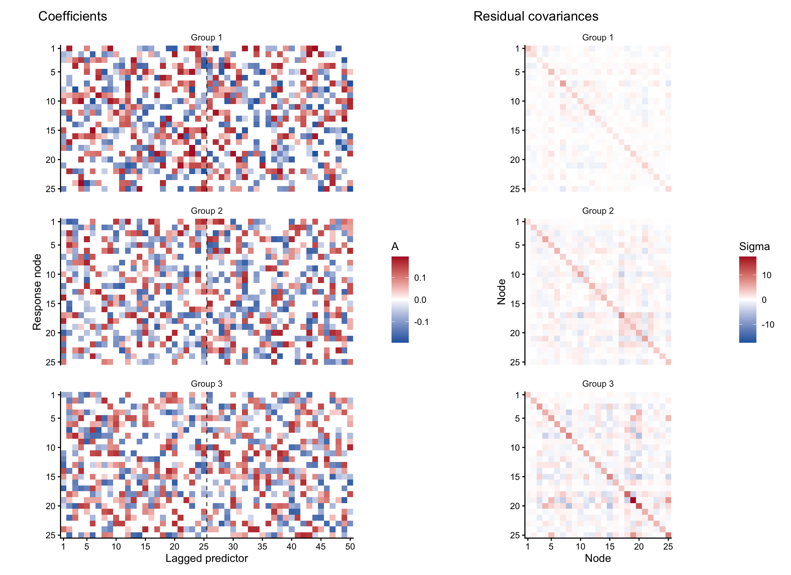

### Fit the model and assess convergence

Fit three chains with different seeds and data-based starts containing
4, 6, and 8 initial groups **in each partition**. All lags share one
coefficient label per subject.

The example uses the default priors and enables both supported
split/merge moves every ten iterations.

``` r
library(PDPMVAR)
```

``` r
chains <- pdpmvar_chains(
  X,
  seeds = c(101, 202, 303),
  initial_clusters = c(4, 6, 8),
  K = K,
  n_factors = B,
  n_burnin = 1500,
  n_mcmc = 1500,
  coefficient_split_merge_every = 10, # split-merge freq for VAR coefs
  split_merge_every = 10 # split-merge freq for covariance
)
```

Each chain runs for 1,500 burn-in and 1,500 retained iterations. Check
both continuous quantities and subject groupings.

``` r
knitr::kable(chains$diagnostics$rhat, digits = 3)
```

| quantity             |  rhat |
|:---------------------|------:|
| coefficient_clusters |    NA |
| covariance_clusters  |    NA |
| log_likelihood       | 1.001 |
| mean_node_variance   | 1.000 |
| coefficient_rms      | 1.002 |
| lambda               | 1.003 |

``` r

summary_columns <- c("chain", "mean_coefficient_clusters", "mean_covariance_clusters",
                     "coefficient_partition_changes", "covariance_partition_changes",
                     "accepted_coefficient_splits", "accepted_coefficient_merges",
                     "accepted_splits", "accepted_merges")
knitr::kable(chains$diagnostics$chains[, summary_columns], digits = 3)
```

| chain | mean_coefficient_clusters | mean_covariance_clusters | coefficient_partition_changes | covariance_partition_changes | accepted_coefficient_splits | accepted_coefficient_merges | accepted_splits | accepted_merges |
|---:|---:|---:|---:|---:|---:|---:|---:|---:|
| 1 | 3 | 3 | 0 | 0 | 0 | 1 | 0 | 0 |
| 2 | 3 | 3 | 0 | 0 | 0 | 3 | 0 | 2 |
| 3 | 3 | 3 | 0 | 0 | 0 | 5 | 0 | 2 |

R-hat compares variation within and between chains after splitting
chains and transforming ranks. Values above 1.01 suggest that more
investigation or sampling is needed. Partition changes count changes in
which subjects share a group, ignoring simple renaming of cluster
labels. In the PDPMVAR table, `accepted_splits` and `accepted_merges`
refer to covariance groups.

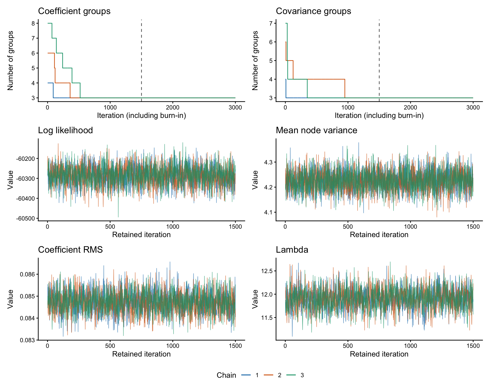

Co-clustering probabilities are the fractions of retained iterations in
which each subject pair belongs to the same group.

``` r
knitr::kable(chains$diagnostics$coclustering_differences, digits = 3)
```

| first | second | component   | mean_difference | max_difference |
|------:|-------:|:------------|----------------:|---------------:|
|     1 |      2 | coefficient |               0 |              0 |
|     1 |      2 | covariance  |               0 |              0 |
|     1 |      3 | coefficient |               0 |              0 |
|     1 |      3 | covariance  |               0 |              0 |
|     2 |      3 | coefficient |               0 |              0 |
|     2 |      3 | covariance  |               0 |              0 |

### Compare the estimated groups with the truth

For each retained draw, compare the subject grouping with the true
grouping using the adjusted Rand index (ARI). An ARI of 1 means the two
partitions agree exactly, regardless of the numeric labels. An ARI near
0 indicates agreement close to what is expected by chance given the
group sizes. The table averages the draw-by-draw ARIs within each chain,
separately for the coefficient and covariance groups.

| chain | mean_A_ARI | mean_Sigma_ARI |
|------:|-----------:|---------------:|
|     1 |          1 |              1 |
|     2 |          1 |              1 |
|     3 |          1 |              1 |

### Compare estimates with the truth

The following comparisons illustrate estimation. They use
subject-specific posterior means, so cluster numbers need not be
matched. We average the three chain means equally; all chains have the
same number of retained draws.

``` r
A_estimate     <- Reduce(`+`, lapply(chains$fits, function(fit) fit$coefficient_mean)) / 3
Sigma_estimate <- Reduce(`+`, lapply(chains$fits, function(fit) fit$covariance_mean)) / 3
A_true         <- A[, , coefficient_group]
Sigma_true     <- Sigma[, , covariance_group]

# Compare subject-level posterior means for each chain and their average.
estimate_rmse <- function(fits, A_average, Sigma_average) {
  data.frame(
    fit = c(paste("Chain", seq_along(fits)), "Equal-chain average"),
    coefficient_rmse = c(vapply(fits, function(fit) {
      sqrt(mean((fit$coefficient_mean - A_true)^2))
    }, numeric(1)), sqrt(mean((A_average - A_true)^2))),
    covariance_rmse = c(vapply(fits, function(fit) {
      sqrt(mean((fit$covariance_mean - Sigma_true)^2))
    }, numeric(1)), sqrt(mean((Sigma_average - Sigma_true)^2)))
  )
}
knitr::kable(estimate_rmse(chains$fits, A_estimate, Sigma_estimate), digits = 4)
```

| fit                 | coefficient_rmse | covariance_rmse |
|:--------------------|-----------------:|----------------:|
| Chain 1             |           0.0283 |          0.1359 |
| Chain 2             |           0.0283 |          0.1372 |
| Chain 3             |           0.0282 |          0.1368 |
| Equal-chain average |           0.0282 |          0.1358 |

RMSE averages squared errors over all matrix entries and all subjects
before taking the square root. Off-diagonal covariance entries appear
twice. For the heatmaps, select one subject from each combination where
both true group labels equal 1, 2, or 3. This selection is for display
only.

``` r
subjects <- vapply(seq_len(n_groups), function(group) {
  which(coefficient_group == group & covariance_group == group)[1]
}, numeric(1))
subjects
#> [1] 4 1 2
```

#### Coefficient matrices

Rows are response nodes and columns are predictors ordered by lag. True
and estimated matrices share a color scale. The dashed line separates
the two lags.

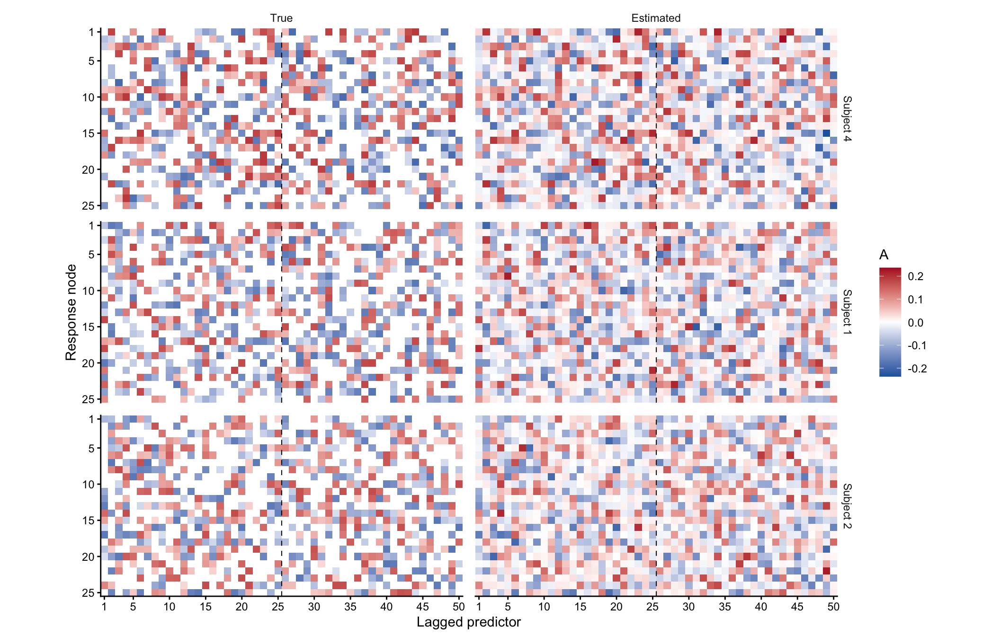

#### Covariance matrices

Both axes index nodes. The same subjects appear in the same order.

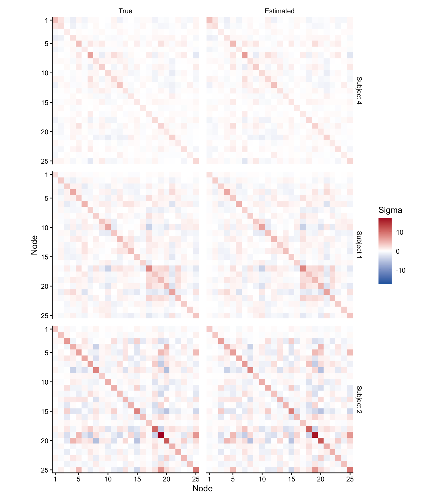

#### Entry-by-entry comparisons

The dashed line marks exact agreement. Coefficient points include all
entries for all subjects. Covariance points include the diagonal and
upper triangle once per subject. Points overlap because subjects share
true matrices.

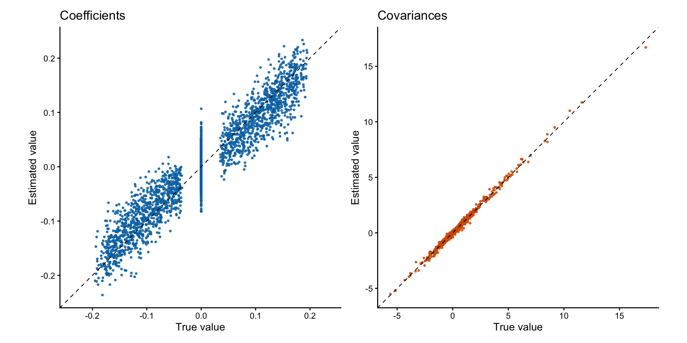

## lgPDPM-VAR

`lgpdpmvar()` lets the subjects form different groups at different lags.
Each label selects a full $D \times D$ coefficient matrix for that lag.
Residual covariance still has its own subject partition. In this
simulation, the **true** coefficient labels happen to agree at both
lags. The lag-specific fit can recover that shared structure while
estimating each partition separately.

### Fit the model and assess convergence

Reuse the same `X` and fit two chains from different data-based starts,
with 1,500 burn-in and 1,500 retained iterations per chain. The
coefficient and covariance split/merge moves run every ten iterations. A
guided single-subject move runs every twenty iterations at each lag.

``` r
lag_chains <- lgpdpmvar_chains(
  X,
  seeds = c(101, 202),
  initial_clusters = c(4, 6),
  K = K,
  n_factors = B,
  n_burnin = 1500,
  n_mcmc = 1500,
  coefficient_split_merge_every = 10,
  split_merge_every = 10,
  coefficient_relocation_every = 20 # unique to lgPDPM-VAR, proposes change in single subject, single lag
)
```

`lgpdpmvar_chains()` reports diagnostics separately for each partition.
The dashed line marks the end of burn-in. Group counts can agree even
when the groups contain different subjects, so also check co-clustering
agreement.

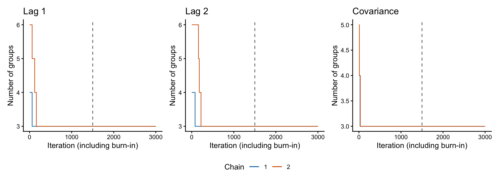

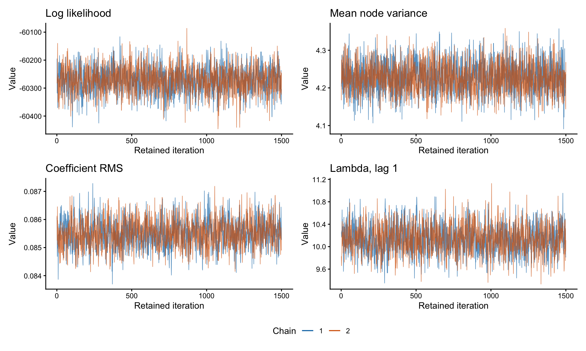

``` r
knitr::kable(lag_chains$diagnostics$rhat, digits = 3)
```

| quantity            |  rhat |
|:--------------------|------:|
| lag_1_clusters      |    NA |
| lag_2_clusters      |    NA |
| covariance_clusters |    NA |
| log_likelihood      | 1.000 |
| mean_node_variance  | 1.001 |
| coefficient_rms     | 1.002 |
| lag_1_lambda        | 1.001 |
| lag_2_lambda        | 1.000 |

``` r
partition_columns <- c("chain", "partition", "mean_clusters", "partition_changes",
                       "accepted_splits", "accepted_merges")
knitr::kable(lag_chains$diagnostics$chains[, partition_columns], digits = 3)
```

| chain | partition | mean_clusters | partition_changes | accepted_splits | accepted_merges |
|---:|:---|---:|---:|---:|---:|
| 1 | lag_1 | 3 | 0 | 0 | 1 |
| 1 | lag_2 | 3 | 0 | 0 | 0 |
| 1 | covariance | 3 | 0 | 0 | 0 |
| 2 | lag_1 | 3 | 0 | 0 | 0 |
| 2 | lag_2 | 3 | 0 | 0 | 1 |
| 2 | covariance | 3 | 0 | 0 | 0 |

``` r
knitr::kable(lag_chains$diagnostics$coclustering_differences, digits = 3)
```

| first | second | partition  | mean_difference | max_difference |
|------:|-------:|:-----------|----------------:|---------------:|
|     1 |      2 | lag_1      |               0 |              0 |
|     1 |      2 | lag_2      |               0 |              0 |
|     1 |      2 | covariance |               0 |              0 |

Both chains recover the three true groups in every retained draw at each
lag and for covariance. The continuous R-hat values are close to 1.
Group-count R-hat is undefined because each count stays at three. The
subject groupings also stay fixed, so these runs show agreement and
recovery on this simulation, with no evidence of movement between
partitions after burn-in.

When true labels are unknown, compare the chains’ co-clustering
probabilities and check how often subjects change groups.

### Compare the estimated groups with the truth

Each fitted chain stores one coefficient label matrix per lag in
`coefficient_labels`, with retained iterations in rows and subjects in
columns. Compare each of these matrices with the same true coefficient
labels. The table gives the mean ARI over retained draws for each
partition.

| chain | lag_1_ARI | lag_2_ARI | covariance_ARI |
|------:|----------:|----------:|---------------:|
|     1 |         1 |         1 |              1 |
|     2 |         1 |         1 |              1 |

### Compare lgPDPMVAR estimates with the truth

Average the subject-specific posterior means from the two chains, which
have the same number of retained draws. The heatmaps use the same three
subjects as the PDPMVAR example above. The coefficient columns show lag
1 and lag 2 side by side, with a dashed line between them.

``` r
lag_A_estimate <- Reduce(`+`, lapply(lag_chains$fits, function(fit) {
  fit$coefficient_mean
})) / length(lag_chains$fits)

lag_Sigma_estimate <- Reduce(`+`, lapply(lag_chains$fits, function(fit) {
  fit$covariance_mean
})) / length(lag_chains$fits)

knitr::kable(estimate_rmse(lag_chains$fits, lag_A_estimate, lag_Sigma_estimate), digits = 4)
```

| fit                 | coefficient_rmse | covariance_rmse |
|:--------------------|-----------------:|----------------:|
| Chain 1             |           0.0282 |          0.1366 |
| Chain 2             |           0.0282 |          0.1381 |
| Equal-chain average |           0.0282 |          0.1366 |

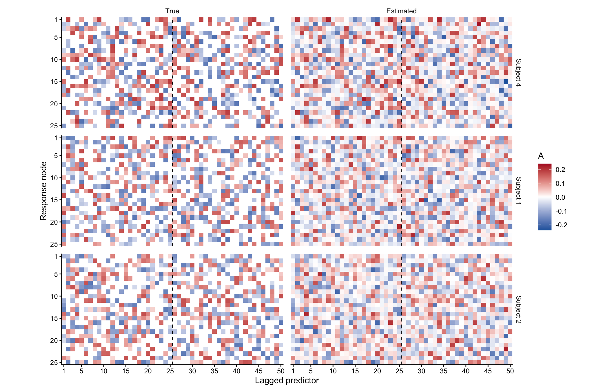

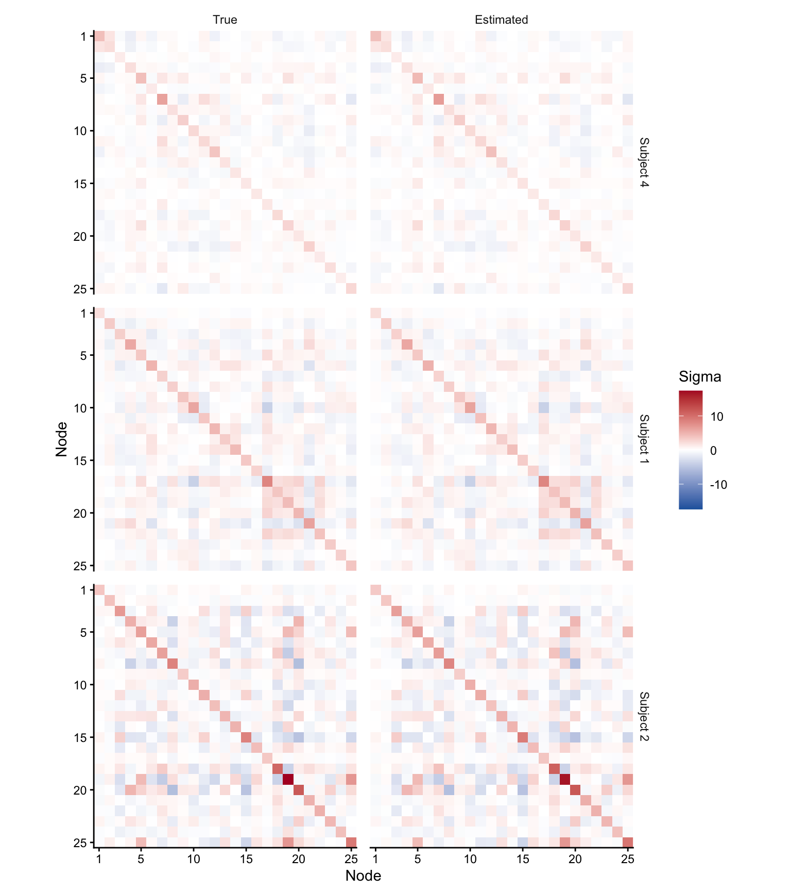

The scatterplots compare entries across all subjects. The covariance
panel uses the diagonal and upper triangle once per subject. The dashed
line marks exact agreement.

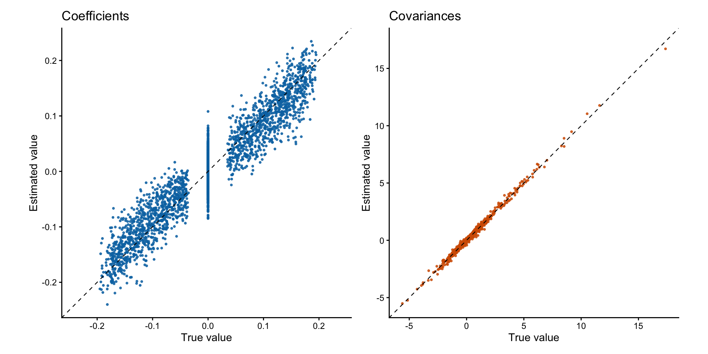

## rgPDPM-VAR

`rgpdpmvar()` gives each response node its own subject partition.
Subjects in the same group for a response share its entire coefficient
row across both lags, a row of length `D * K`. Residual covariance has a
separate partition. We reuse the same toy data, where the true
coefficient groups happen to agree across all response nodes.

### Fit the model and assess convergence

Fit two chains with four and six starting groups, respectively, using
1,500 burn-in and 1,500 retained iterations per chain. Both split/merge
moves are attempted every ten iterations. A guided single-subject move
also runs every ten iterations at each response node.

``` r
row_chains <- rgpdpmvar_chains(
  X,
  seeds = c(101, 202),
  initial_clusters = c(4, 6),
  K = K,
  n_factors = B,
  n_burnin = 1500,
  n_mcmc = 1500,
  coefficient_split_merge_every = 10,
  split_merge_every = 10,
  coefficient_relocation_every = 10
)
row_fits <- row_chains$fits
```

The traces show group counts for two example response nodes and
covariance. The dashed line marks the end of burn-in.
`rgpdpmvar_chains()` calls `rgpdpmvar_diagnostics()` to compare the
fitted chains. You can also call `rgpdpmvar_diagnostics(row_fits)` if
you already have the fits.

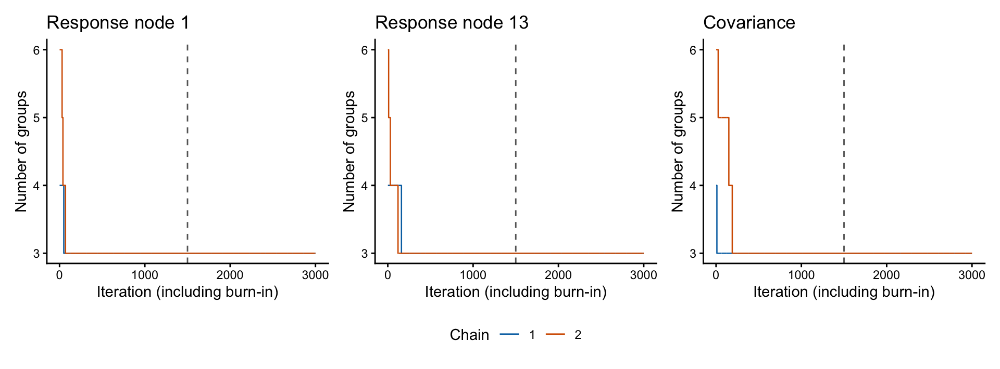

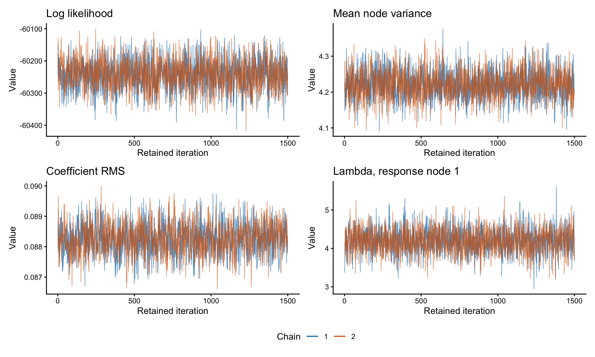

``` r
row_diagnostics <- row_chains$diagnostics
continuous <- colnames(row_fits[[1]]$parameter_traces)
knitr::kable(subset(row_diagnostics$rhat, quantity %in% continuous), digits = 3, row.names = FALSE)
```

| quantity           |  rhat |
|:-------------------|------:|
| log_likelihood     | 1.001 |
| mean_node_variance | 1.001 |
| coefficient_rms    | 1.001 |

For each response node and for covariance, the co-clustering table
compares how often subject pairs share a group. The chain table also
reports how often each partition changes and how many splits and merges
were accepted.

<details>

<summary>

Show agreement for all response nodes and covariance
</summary>

``` r
knitr::kable(subset(row_diagnostics$rhat, !quantity %in% continuous), digits = 3, row.names = FALSE)
```

| quantity            |  rhat |
|:--------------------|------:|
| node_1_clusters     |    NA |
| node_2_clusters     |    NA |
| node_3_clusters     |    NA |
| node_4_clusters     |    NA |
| node_5_clusters     |    NA |
| node_6_clusters     |    NA |
| node_7_clusters     | 1.050 |
| node_8_clusters     |    NA |
| node_9_clusters     |    NA |
| node_10_clusters    |    NA |
| node_11_clusters    |    NA |
| node_12_clusters    |    NA |
| node_13_clusters    |    NA |
| node_14_clusters    |    NA |
| node_15_clusters    |    NA |
| node_16_clusters    |    NA |
| node_17_clusters    |    NA |
| node_18_clusters    |    NA |
| node_19_clusters    |    NA |
| node_20_clusters    |    NA |
| node_21_clusters    |    NA |
| node_22_clusters    |    NA |
| node_23_clusters    |    NA |
| node_24_clusters    |    NA |
| node_25_clusters    |    NA |
| covariance_clusters |    NA |
| node_1_lambda       | 1.000 |
| node_2_lambda       | 1.000 |
| node_3_lambda       | 1.001 |
| node_4_lambda       | 1.000 |
| node_5_lambda       | 1.001 |
| node_6_lambda       | 1.000 |
| node_7_lambda       | 1.001 |
| node_8_lambda       | 1.000 |
| node_9_lambda       | 1.001 |
| node_10_lambda      | 1.002 |
| node_11_lambda      | 1.000 |
| node_12_lambda      | 1.000 |
| node_13_lambda      | 1.000 |
| node_14_lambda      | 1.000 |
| node_15_lambda      | 1.000 |
| node_16_lambda      | 1.000 |
| node_17_lambda      | 1.000 |
| node_18_lambda      | 1.000 |
| node_19_lambda      | 1.001 |
| node_20_lambda      | 1.002 |
| node_21_lambda      | 1.000 |
| node_22_lambda      | 1.001 |
| node_23_lambda      | 1.000 |
| node_24_lambda      | 1.001 |
| node_25_lambda      | 1.001 |

``` r
knitr::kable(row_diagnostics$chains[, partition_columns], digits = 3)
```

| chain | partition | mean_clusters | partition_changes | accepted_splits | accepted_merges |
|---:|:---|---:|---:|---:|---:|
| 1 | node_1 | 3.000 | 0 | 0 | 0 |
| 1 | node_2 | 3.000 | 0 | 0 | 0 |
| 1 | node_3 | 3.000 | 0 | 0 | 0 |
| 1 | node_4 | 3.000 | 0 | 0 | 0 |
| 1 | node_5 | 3.000 | 0 | 0 | 0 |
| 1 | node_6 | 3.000 | 0 | 0 | 0 |
| 1 | node_7 | 3.047 | 2 | 1 | 0 |
| 1 | node_8 | 3.000 | 0 | 0 | 0 |
| 1 | node_9 | 3.000 | 0 | 0 | 1 |
| 1 | node_10 | 3.000 | 0 | 0 | 0 |
| 1 | node_11 | 3.000 | 0 | 0 | 0 |
| 1 | node_12 | 3.000 | 0 | 0 | 1 |
| 1 | node_13 | 3.000 | 0 | 0 | 0 |
| 1 | node_14 | 3.000 | 0 | 0 | 0 |
| 1 | node_15 | 3.000 | 0 | 0 | 0 |
| 1 | node_16 | 3.000 | 0 | 0 | 0 |
| 1 | node_17 | 3.000 | 0 | 0 | 1 |
| 1 | node_18 | 3.000 | 0 | 0 | 0 |
| 1 | node_19 | 3.000 | 0 | 1 | 0 |
| 1 | node_20 | 3.000 | 0 | 0 | 0 |
| 1 | node_21 | 3.000 | 0 | 0 | 1 |
| 1 | node_22 | 3.000 | 0 | 0 | 0 |
| 1 | node_23 | 3.000 | 0 | 0 | 0 |
| 1 | node_24 | 3.000 | 0 | 0 | 0 |
| 1 | node_25 | 3.000 | 0 | 0 | 0 |
| 1 | covariance | 3.000 | 0 | 0 | 0 |
| 2 | node_1 | 3.000 | 0 | 0 | 0 |
| 2 | node_2 | 3.000 | 0 | 0 | 0 |
| 2 | node_3 | 3.000 | 0 | 0 | 0 |
| 2 | node_4 | 3.000 | 0 | 0 | 0 |
| 2 | node_5 | 3.000 | 0 | 0 | 0 |
| 2 | node_6 | 3.000 | 0 | 0 | 0 |
| 2 | node_7 | 3.000 | 0 | 1 | 0 |
| 2 | node_8 | 3.000 | 0 | 0 | 0 |
| 2 | node_9 | 3.000 | 0 | 0 | 0 |
| 2 | node_10 | 3.000 | 0 | 0 | 1 |
| 2 | node_11 | 3.000 | 0 | 0 | 0 |
| 2 | node_12 | 3.000 | 0 | 0 | 0 |
| 2 | node_13 | 3.000 | 0 | 0 | 0 |
| 2 | node_14 | 3.000 | 0 | 0 | 1 |
| 2 | node_15 | 3.000 | 0 | 0 | 0 |
| 2 | node_16 | 3.000 | 0 | 0 | 0 |
| 2 | node_17 | 3.000 | 0 | 1 | 1 |
| 2 | node_18 | 3.000 | 0 | 0 | 0 |
| 2 | node_19 | 3.000 | 0 | 1 | 0 |
| 2 | node_20 | 3.000 | 0 | 0 | 0 |
| 2 | node_21 | 3.000 | 0 | 0 | 0 |
| 2 | node_22 | 3.000 | 0 | 0 | 0 |
| 2 | node_23 | 3.000 | 0 | 0 | 1 |
| 2 | node_24 | 3.000 | 0 | 0 | 1 |
| 2 | node_25 | 3.000 | 0 | 0 | 0 |
| 2 | covariance | 3.000 | 0 | 0 | 2 |

``` r
knitr::kable(row_diagnostics$coclustering_differences, digits = 3)
```

| first | second | partition  | mean_difference | max_difference |
|------:|-------:|:-----------|----------------:|---------------:|
|     1 |      2 | node_1     |           0.000 |          0.000 |
|     1 |      2 | node_2     |           0.000 |          0.000 |
|     1 |      2 | node_3     |           0.000 |          0.000 |
|     1 |      2 | node_4     |           0.000 |          0.000 |
|     1 |      2 | node_5     |           0.000 |          0.000 |
|     1 |      2 | node_6     |           0.000 |          0.000 |
|     1 |      2 | node_7     |           0.001 |          0.047 |
|     1 |      2 | node_8     |           0.000 |          0.000 |
|     1 |      2 | node_9     |           0.000 |          0.000 |
|     1 |      2 | node_10    |           0.000 |          0.000 |
|     1 |      2 | node_11    |           0.000 |          0.000 |
|     1 |      2 | node_12    |           0.000 |          0.000 |
|     1 |      2 | node_13    |           0.000 |          0.000 |
|     1 |      2 | node_14    |           0.000 |          0.000 |
|     1 |      2 | node_15    |           0.000 |          0.000 |
|     1 |      2 | node_16    |           0.000 |          0.000 |
|     1 |      2 | node_17    |           0.000 |          0.000 |
|     1 |      2 | node_18    |           0.000 |          0.000 |
|     1 |      2 | node_19    |           0.000 |          0.000 |
|     1 |      2 | node_20    |           0.000 |          0.000 |
|     1 |      2 | node_21    |           0.000 |          0.000 |
|     1 |      2 | node_22    |           0.000 |          0.000 |
|     1 |      2 | node_23    |           0.000 |          0.000 |
|     1 |      2 | node_24    |           0.000 |          0.000 |
|     1 |      2 | node_25    |           0.000 |          0.000 |
|     1 |      2 | covariance |           0.000 |          0.000 |

</details>

Both chains recover the covariance grouping and the true partitions at
24 of the 25 response nodes in every retained draw. One chain has some
different assignments at node 7. Compared with the same example with
relocation disabled, the largest co-clustering difference falls from
1.000 to 0.047, and the log-likelihood R-hat falls from 1.032 to 1.001.

### Compare the estimated groups with the truth

Each fit stores one matrix of subject labels per response node in
`coefficient_labels`, with retained iterations in rows and subjects in
columns. For each node, we average ARI across retained draws, then
summarize those values across the 25 nodes. Covariance has one ARI per
chain.

| chain | mean_row_ARI | median_row_ARI | min_row_ARI | covariance_ARI |
|------:|-------------:|---------------:|------------:|---------------:|
|     1 |            1 |              1 |       0.997 |              1 |
|     2 |            1 |              1 |       1.000 |              1 |

<details>

<summary>

Show ARI by response node
</summary>

|         | Chain 1 | Chain 2 |
|:--------|--------:|--------:|
| node_1  |   1.000 |       1 |
| node_2  |   1.000 |       1 |
| node_3  |   1.000 |       1 |
| node_4  |   1.000 |       1 |
| node_5  |   1.000 |       1 |
| node_6  |   1.000 |       1 |
| node_7  |   0.997 |       1 |
| node_8  |   1.000 |       1 |
| node_9  |   1.000 |       1 |
| node_10 |   1.000 |       1 |
| node_11 |   1.000 |       1 |
| node_12 |   1.000 |       1 |
| node_13 |   1.000 |       1 |
| node_14 |   1.000 |       1 |
| node_15 |   1.000 |       1 |
| node_16 |   1.000 |       1 |
| node_17 |   1.000 |       1 |
| node_18 |   1.000 |       1 |
| node_19 |   1.000 |       1 |
| node_20 |   1.000 |       1 |
| node_21 |   1.000 |       1 |
| node_22 |   1.000 |       1 |
| node_23 |   1.000 |       1 |
| node_24 |   1.000 |       1 |
| node_25 |   1.000 |       1 |

</details>

### Compare rgPDPMVAR estimates with the truth

The heatmaps compare the same three subjects as above. We average the
two chains’ subject-specific posterior means equally for display and
report estimation error for each chain as well. Averaging alone does not
establish agreement across chains.

``` r
row_A_estimate <- Reduce(`+`, lapply(row_fits, function(fit) {
  fit$coefficient_mean
})) / length(row_fits)

row_Sigma_estimate <- Reduce(`+`, lapply(row_fits, function(fit) {
  fit$covariance_mean
})) / length(row_fits)

knitr::kable(estimate_rmse(row_fits, row_A_estimate, row_Sigma_estimate), digits = 4)
```

| fit                 | coefficient_rmse | covariance_rmse |
|:--------------------|-----------------:|----------------:|
| Chain 1             |           0.0285 |          0.1403 |
| Chain 2             |           0.0285 |          0.1409 |
| Equal-chain average |           0.0285 |          0.1400 |

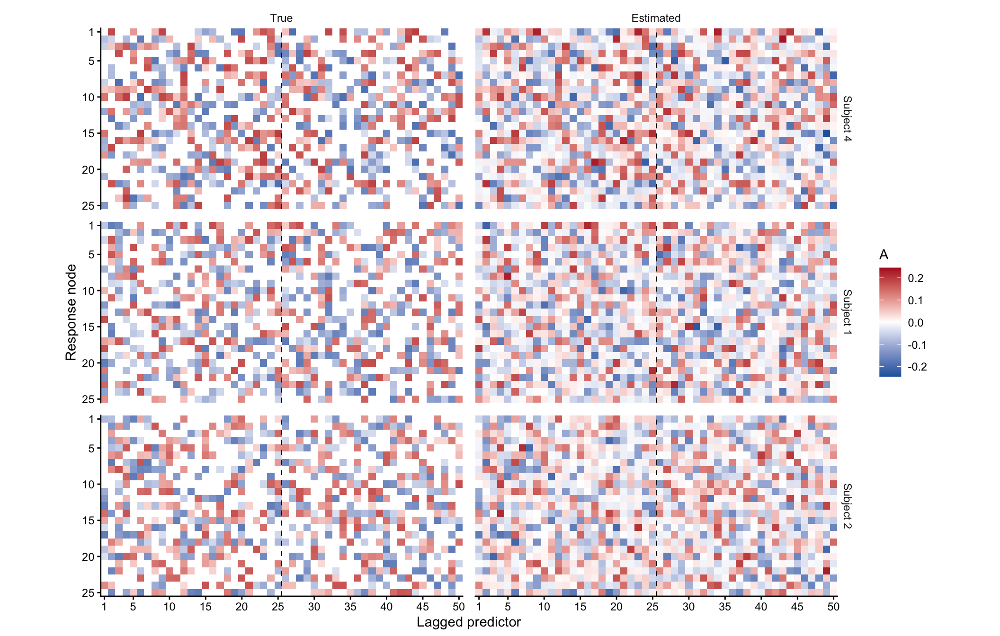


The scatterplots use all subjects. The covariance panel counts each
diagonal and upper-triangular entry once per subject.

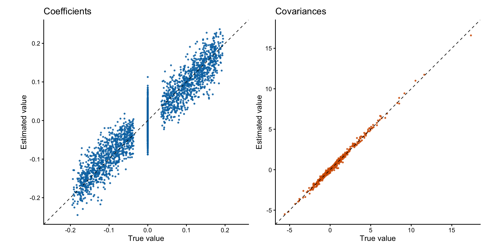

### Compare with separate and oracle VAR fits

Fit an ordinary least-squares VAR for each subject using
`stats::ar.ols()`. Use the same two lags, subject-specific centering and
zero padding as in the PDPMVAR fits. Each regression has no intercept
and estimates its coefficients and residual covariance using only that
subject’s observations. The residual covariance from `ar.ols()` divides
by the number of time points.

``` r
individual_series <- lapply(X, function(x) {
  centered <- sweep(x, 1, rowMeans(x), "-")
  rbind(matrix(0, K, D), t(centered))
})
individual_fits <- lapply(individual_series, function(series) {
  stats::ar.ols(series, aic = FALSE, order.max = K, demean = FALSE, intercept = FALSE)
})

# ar.ols stores coefficients by lag, response and predictor. Rearrange
# them as D x (D * K) x N, with lag blocks side by side for each subject.
individual_A <- simplify2array(lapply(individual_fits, function(fit) {
  matrix(aperm(fit$ar, c(2, 3, 1)), nrow = D)
}))
individual_Sigma <- simplify2array(lapply(individual_fits, function(fit) fit$var.pred))
```

The oracle VAR fits use the true subject labels from the simulation.
Both estimate a shared coefficient matrix and residual covariance by
ordinary least squares within each group.

- **Coefficient groups.** Pool subjects with the same true VAR
  coefficients across both lags. Subjects in a coefficient group can
  have different true covariances.
- **Coefficient and covariance combinations.** Pool subjects only when
  both true labels agree. This gives a separate fit for each observed
  combination, including combinations with just one subject.

``` r
# Build the regression rows within each subject before pooling. Each
# matrix has T rows and D * (K + 1) columns, with responses first.
subject_regressions <- lapply(individual_series, stats::embed, dimension = K + 1)

# Fit one VAR per supplied group and return the estimates in subject order.
# Coefficients are D x (D * K) x N and covariances are D x D x N.
fit_oracle_var <- function(groups) {
  members <- split(seq_len(N), groups, drop = TRUE)
  pooled <- lapply(members, function(subjects) {
    regression <- do.call(rbind, subject_regressions[subjects])
    fit <- stats::lm.fit(regression[, -seq_len(D), drop = FALSE],
                        regression[, seq_len(D), drop = FALSE])
    list(A = t(fit$coefficients), Sigma = crossprod(fit$residuals) / nrow(regression))
  })
  by_subject <- unname(pooled[as.character(groups)])
  list(A = simplify2array(lapply(by_subject, `[[`, "A")),
       Sigma = simplify2array(lapply(by_subject, `[[`, "Sigma")))
}

oracle_coefficient <- fit_oracle_var(coefficient_group)
joint_group <- interaction(coefficient_group, covariance_group, drop = TRUE)
oracle_joint <- fit_oracle_var(joint_group)
```

Compare the least-squares fits and the three mixture models’ equal-chain
posterior means with the known simulated matrices. RMSE is calculated
over all subjects and matrix entries.

``` r
estimates <- list(
  "Separate VAR"                   = list(A = individual_A, Sigma = individual_Sigma),
  "Oracle VAR, coefficient groups" = oracle_coefficient,
  "Oracle VAR, joint groups"        = oracle_joint,
  "PDPMVAR"                        = list(A = A_estimate, Sigma = Sigma_estimate),
  "lgPDPM-VAR"                     = list(A = lag_A_estimate, Sigma = lag_Sigma_estimate),
  "rgPDPM-VAR"                     = list(A = row_A_estimate, Sigma = row_Sigma_estimate)
)

rmse <- function(estimate, truth) sqrt(mean((estimate - truth)^2))
knitr::kable(data.frame(
  model = names(estimates),
  coefficient_rmse = vapply(estimates, function(fit) rmse(fit$A, A_true), numeric(1)),
  covariance_rmse = vapply(estimates, function(fit) rmse(fit$Sigma, Sigma_true), numeric(1)),
  row.names = NULL
), digits = 4)
```

| model                          | coefficient_rmse | covariance_rmse |
|:-------------------------------|-----------------:|----------------:|
| Separate VAR                   |           0.1777 |          0.7609 |
| Oracle VAR, coefficient groups |           0.0414 |          0.9412 |
| Oracle VAR, joint groups       |           0.0873 |          0.3628 |
| PDPMVAR                        |           0.0282 |          0.1358 |
| lgPDPM-VAR                     |           0.0282 |          0.1366 |
| rgPDPM-VAR                     |           0.0285 |          0.1400 |

Pooling by coefficient group gives the more accurate oracle coefficient
estimates. Pooling by both labels gives the more accurate oracle
covariance estimates, but divides subjects who share the same
coefficient matrix into smaller groups. The mixture models can share
coefficients and covariances across different sets of subjects.

## Acknowledgments

We used OpenAI Codex to help translate the original Julia implementation
into R and C++ with RcppEigen, and to develop tests and documentation
for the package.
